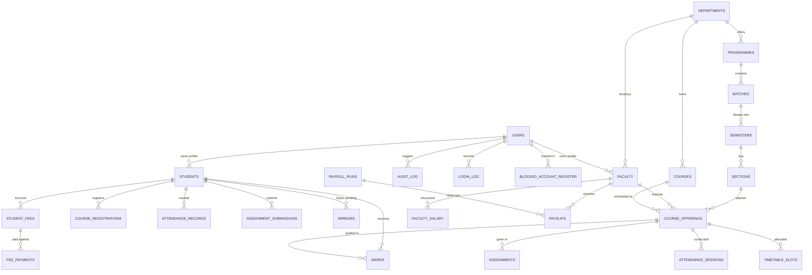

# CampusFlow — Smart College Portal
Enterprise College Management Portal built with **React 18 + TypeScript + Vite**, **Java 21 / Spring Boot 3**, and **MySQL 8**.


---

## 1. System Architecture

| Layer | Technology |
|---|---|
| **Frontend** | React 18, Vite, TypeScript, Tailwind CSS, Lucide Icons, Recharts, TanStack Query |
| **Typography** | Headings: Plus Jakarta Sans; Body: Inter; Tabular/IDs: JetBrains Mono |
| **Backend** | Java 21 / 23, Spring Boot 3.3.5 (Web, Security, Data JPA, Validation, Mail, Cache, Actuator) |
| **Database** | Local MySQL 8.4 Server (InnoDB, utf8mb4), HikariCP Connection Pool |
| **Migrations** | Flyway (`V1__init_schema.sql`, `V2__indexes.sql`, `V3__seed_reference_data.sql`) |
| **Authentication** | JWT Access Token (15 min) + Refresh Token, BCrypt (strength 12) |
| **Security & Privacy** | AES-256-GCM encryption for sensitive PII (Aadhaar, Bank details) with masked display and logged reveals (DPDP Act 2023 compliance) |
| **Document Generation** | OpenPDF (Payslips, Fee Receipts, Grade Sheets), Apache POI (Excel export), OpenCSV |

---

## 2. Run Locally With My MySQL

### Step 1: Configure Credentials in `.env`
Open `.env` in the `college-portal/` folder and fill in your local MySQL password:

```env
DB_HOST=localhost
DB_PORT=3306
DB_NAME=college_portal
DB_USER=root
DB_PASSWORD=your_mysql_password_here
```

*(Optional dedicated user)*: If you prefer creating a dedicated non-root user, execute `db/setup_mysql.sql` in MySQL Workbench or CLI:
```sql
CREATE DATABASE IF NOT EXISTS college_portal CHARACTER SET utf8mb4 COLLATE utf8mb4_unicode_ci;
CREATE USER IF NOT EXISTS 'portal_user'@'localhost' IDENTIFIED BY 'portal_pass123';
GRANT ALL PRIVILEGES ON college_portal.* TO 'portal_user'@'localhost';
FLUSH PRIVILEGES;
```

### Step 2: One-Click Launch
Double-click or run:
```cmd
start-all.bat
```
This automatically:
1. Loads environment variables from `.env`.
2. Connects to your local MySQL 8 on `localhost:3306`.
3. Auto-creates `college_portal` database if it doesn't already exist.
4. Executes Flyway migrations `V1` through `V3`.
5. Seeds realistic demo records across all modules (students, faculty, timetable, attendance, marks, fees, arrears).
6. Starts the Spring Boot backend API on `http://localhost:8080`.
7. Starts the Vite React frontend on `http://localhost:5173`.

---

## 3. Dedicated Login Portals

Three separate login pathways are enforced on both UI and server:

| Portal | URL | Accent | Default Credentials |
|---|---|---|---|
| **Admin Portal** | [http://localhost:5173/admin/login](http://localhost:5173/admin/login) | Indigo (`#4F46E5`) | `admin@college.local` / `Admin@12345` |
| **Faculty Portal** | [http://localhost:5173/faculty/login](http://localhost:5173/faculty/login) | Teal (`#0F766E`) | `teacher1@college.local` / `Demo@12345` |
| **Student Portal** | [http://localhost:5173/student/login](http://localhost:5173/student/login) | Violet (`#7C3AED`) | `student1@college.local` / `Demo@12345` |

*(Student ID login also supported: `25CSE0001` .. `25CSE0015` with password `Demo@12345`)*.

---

## 4. Entity Relationship Diagram (3NF Normalized)



---

## 5. Security & Verification Notes

- **Password Policy**: Minimum 8 characters, with uppercase, lowercase, digit, and symbol. Cannot match default password.
- **Lockout Mechanism**: 5 consecutive failed login attempts automatically locks the account for 15 minutes and writes an entry to `blocked_account_register`.
- **First Login Forced Reset**: Accounts flagged with `must_change_password=TRUE` are restricted from accessing any API endpoint until a new strong password is set.
- **DPDP Act 2023 Masking**: Aadhaar numbers are AES-GCM encrypted in the database. UI shows masked `XXXX XXXX 1234`. Every reveal action by an administrator is recorded in `audit_log` with user ID, IP address, and timestamp.
